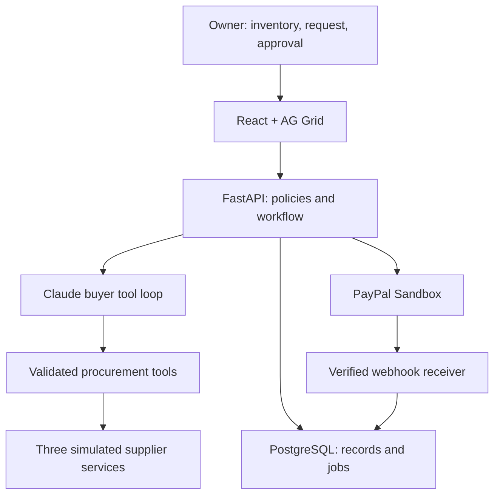

# TradePilot AI

**AI procurement with human-approved PayPal payments.**

TradePilot AI helps a small electronics retailer turn a restocking request into a verified purchase: inspect sales and inventory, obtain supplier quotes, negotiate within real constraints, compare compatible alternatives, obtain approval for an exact cart, pay through PayPal Sandbox, and reconcile the purchase.

**Product promise:** the agent can negotiate and recommend; it cannot silently change what the owner approved.

> BUILD CONTRACT — This README is the implementation specification for a new application, not a claim that the application already exists. Give it and `CLAUDE_BUILD_PROMPT.md` to Claude Code. Implement the required behavior, then update the status, screenshots, commands, and evidence to match the actual build. Do not label simulated data, test fixtures, or unexecuted integrations as live or verified.

## 1. Product, audience, and scope

**Primary user:** the owner or purchasing manager of a small electronics shop selling cables, chargers, headphones, and phone accessories.

**Problem:** restocking requires reconciling stock, estimating needs, comparing delivered prices, checking compatibility and delivery dates, negotiating, and tracking payment. A cheap quote can become expensive through shipping, late delivery, incompatible products, or a stale price.

**Example request:**

> Use our recent sales and current inventory to prepare this weekend's restock. Keep the complete delivered total below $500, require delivery by Friday, and preserve the required product specifications. Explain the best offer before I pay.

The system must also support explicit quantities, such as “Buy 10 USB-C 65W PD chargers and 20 one-metre USB-C cables.” Missing material constraints must be collected in a short confirmation form. Do not infer binding deadlines or spending limits from ambiguous text.

### Required MVP

- One fictional retailer, 20 seeded products, 28 days of synthetic sales, three simulated suppliers.
- Inventory and sales import from bounded, validated CSV files.
- Transparent restocking calculations and editable, validated requirements.
- One buyer agent using real LLM tool calls; supplier services enforce independent commercial rules.
- Quotes, bounded negotiation, compatible surplus alternatives, and deterministic offer comparison.
- One complete basket from one selected supplier per purchase; no split-supplier checkout.
- Exact-cart owner approval, PayPal Sandbox checkout, server-side capture, verified webhooks, and reconciliation.
- Persistent purchase records, decision summaries, and recovery after timeouts or restarts.
- AG Grid Community in the core workflow, Render deployment configuration, and a Postman collection.
- Functional responsive UI, meaningful automated tests, setup documentation, and an under-three-minute demo plan.

### Explicitly deferred

Do not build a general marketplace, paid-agent marketplace, microtransaction billing, voice purchasing, autonomous spending, seller dispute-defense system, real supplier onboarding, live-money support, complex forecasting, vector search, Kubernetes, Redis, Kafka, or a collection of agents for every screen. No LangGraph or MCP requirement for this MVP: a bounded tool loop and ordinary service functions are sufficient. Interfaces can remain clear without speculative plugin frameworks.

Surplus offers are ordinary supplier quotes with relevant discounted items, not a separate marketplace. They may only replace requested goods when compatibility rules allow it. No unrelated stock added merely to make a bundle look cheaper.

## 2. Required integrations and selected sponsor technology

The organizer information supplied for this project requires meaningful PayPal and AI integration; sponsor tools are optional. We deliberately select three supporting tools. This choice does not assert eligibility for any particular sponsor prize; check the official rules and sponsor-specific conditions before submission.

| Technology | Concrete implementation | Evidence judges can inspect |
| --- | --- | --- |
| PayPal Sandbox — required platform | Orders v2 create/retrieve/capture, browser checkout, signature-verified webhooks, payment reconciliation | Sandbox order and capture IDs, real checkout recording, recovery timeline, adapter tests |
| Anthropic Claude API — required AI functionality | Parse purchase intent; choose quote/negotiation tools; propose alternatives; explain grounded tradeoffs | Actual tool calls, redacted tool results, token usage, decision summaries, evaluation cases |
| AG Grid Community — sponsor | Interactive inventory grid and offer-comparison grid, filtering, sorting, status renderers, row selection, live updates, CSV export | Real application data and actions in both grids; no decorative empty grid |
| Render — sponsor | Docker web service serving React and FastAPI from one origin, plus managed PostgreSQL, configured by `render.yaml` | Deployable blueprint; hosted URL and deployment evidence if actually deployed |
| Postman — sponsor | Versioned collection and safe example environment covering procurement and payment endpoints, with assertions and negative cases | Importable collection, local runner instructions, exported run results when actually executed |

AG Grid Community is MIT licensed and requires no Enterprise license. Use Community features only; do not import `ag-grid-enterprise`, depend on trial keys, or implement Enterprise grouping, pivoting, Excel export, or integrated charts. Use an external “Export CSV” button rather than an Enterprise context menu. Preserve dependency license notices.

Render is a deployment target, not an assumed free hosting entitlement. Do not promise that a web service, database, API calls, or sponsor credits are free. Supply configuration and setup instructions; the owner selects a current plan and authorizes resource creation. No other sponsor integrations are required.

## 3. Architecture and implementation choices

Use a small monorepo with one application service and PostgreSQL.

| Layer | Choice |
| --- | --- |
| UI | React, TypeScript in strict mode, Vite, AG Grid Community, plain CSS with design tokens |
| API | Python 3.12+, FastAPI, Pydantic, SQLAlchemy, Alembic, HTTPX |
| AI | Official Anthropic Python SDK, configured model ID, client-side tool use |
| Storage | PostgreSQL; same database engine in local integration tests and deployment |
| Background execution | Small persisted jobs table and in-process async poller; one app instance/worker for MVP |
| Packaging | Docker multi-stage build, Docker Compose, locked dependencies |
| Verification | Pytest for business/payment integration, Playwright for critical browser paths, TypeScript/build checks |
| API tooling | FastAPI OpenAPI document plus Postman collection and example environment |

Keep Node and Python versions pinned in the generated project after checking compatibility. Do not invent package versions or assume an unverified “latest” API. A coding subscription is not a runtime API key: Claude Code building the app and Claude API powering the app are separate uses.



The diagram shows logical boundaries, not separate deployed microservices. Supplier services are ordinary backend modules with independent seeded data and rules. The buyer cannot read supplier private discount floors; tools expose only allowed quotes and counteroffers.

**Payment routing boundary:** all fictional suppliers are offer sources behind one demo storefront. The configured PayPal Sandbox business account is the sole payment recipient, and a distinct sandbox personal account is the buyer. Display this limitation clearly. Do not claim real multi-vendor settlement, escrow, payouts, supplier onboarding, or payments to three separate merchants. Future real suppliers would require a separately designed and authorized payment/onboarding integration.

## 4. Functional workflow

### 4.1 Inventory and requirement preparation

Seed products with SKU, name, category, canonical compatibility attributes, on-hand quantity, incoming quantity, and safety-stock units. Relevant attributes include connector type, power rating, supported charging protocol, cable length, and required certification flags in the synthetic dataset. Do not make unsupported claims that real products are certified.

Calculate proposed need per SKU using an inspectable heuristic:

```text
daily_sales = units_sold_in_last_28_complete_days / 28
target_units = ceil(daily_sales * coverage_days) + safety_stock_units
shortage = max(0, target_units - on_hand - confirmed_incoming)
```

Use a fixed seeded business date in tests; derive relative demo deadlines from the scenario's business date at reset so they never become stale. Store resolved dates and timezone. Display the date range, formula, missing-data warnings, and editable coverage days. Do not call this trained forecasting. If sales history is insufficient, ask for quantities or use a clearly labeled fallback rather than manufacturing precision.

The owner confirms the requirements before supplier activity. Model output is a proposal: validate quantities, known SKU IDs, USD budget, deadline, and compatibility before accepting it. Any non-USD request receives a clear supported-currency message; no silent conversion.

CSV import must have file-size and row limits, explicit column schemas, a preview, row-level validation errors, and atomic application after confirmation. Inventory imports set counted on-hand quantities; sales imports append validated sales with stable import identifiers to avoid duplication. Incoming purchases are not counted as physically received stock.

### 4.2 Supplier quotes and negotiation

Every supplier has its own stock, quantity minimums, price schedule, discount floor, shipping charges, delivery commitments, surplus offers, quote TTL, and revision number. These values are authoritative server-side data. Supplier messages may use friendly wording, but an LLM must not fabricate a concession or rewrite a supplier's price.

The buyer agent can request quotes and counteroffer within at most three negotiation rounds per supplier. A deterministic supplier policy accepts, rejects, or counters. Persist each exchange, the applicable quote revision, expiry, and rationale code. Rate-limit runs and bound total tool calls and output tokens.

Every offer must cover the confirmed basket in full. Reject offers violating quantity, stock, specifications, delivery deadline, or currency. Then select the lowest delivered total within the budget. Tie-break by earlier delivery and then stable supplier ID. If nothing is feasible, return “No feasible offer” with concrete changes the owner could approve; never quietly drop products or raise the budget.

Delivered total = sum of quantity × unit price − applicable discounts + shipping + explicitly modeled tax. All amounts use integer USD cents. For seed data, tax can be zero if marked “synthetic scenario: tax excluded”; do not imply a real tax calculation. Do not double-count line discounts and order discounts. Use Decimal only at provider serialization boundaries; never binary floating-point arithmetic for stored money.

### 4.3 Approval and quote changes

Show exact products/specifications, quantities, selected supplier, subtotal, discounts, shipping, tax assumption, total, currency, delivery deadline, quote expiry, and the alternative comparison.

Create an immutable purchase snapshot and a canonical digest covering its material fields and quote revision. Store approval against this snapshot, session, timestamp, and expiry. The digest supplements normal database ownership and validation; it is not a substitute for authorization.

Revalidate immediately before creating the PayPal order and immediately before capture. Changed price, supplier, item, quantity, specification, delivery terms, expired quote, or invalid reservation requires a new snapshot and fresh owner approval. A price reduction is still a change to the approved contract. Invalidate and retire stale checkout records; an old browser callback must not capture a replaced order.

Quote expiry prevents new reservations. Once an approved quote is reserved, supplier terms are frozen for a short, explicit checkout reservation window. At capture, require this reservation to remain valid and match the snapshot. Do not shorten a valid reservation because the earlier unreserved quote TTL ended.

Do not hold a database transaction or row lock across an external HTTP call. Claim work and persist its intent first, call the provider, then finalize through the shared reconciliation path. External payment and local database changes are not one atomic transaction.

### 4.4 Checkout and reconciliation

1. Acquire an atomic supplier-stock reservation and persist the approved purchase plus create-operation ID before calling PayPal.
2. Server creates a PayPal Orders v2 order using the stored snapshot, configured merchant, USD, and `CAPTURE` intent. Persist the request ID and order mapping. Browser amounts are never authoritative.
3. Browser opens the official PayPal checkout experience; the buyer approves using a separate sandbox personal account. The application's owner approval does not replace PayPal buyer approval.
4. The server validates session ownership, the mapped order, approved snapshot, reservation, and current operation state before capture.
5. Server captures with a distinct stable `PayPal-Request-Id` for that logical capture. Repeat clicks reuse the same operation; they do not create another purchase or key.
6. Validate provider order/capture correlation, status, gross amount, currency, and intended recipient against stored expectations. Do not confuse the recipient's net proceeds after fees with the approved gross total. Mark paid only from trusted server-side provider evidence.
7. Atomically persist capture evidence, append one purchase-ledger entry, consume the supplier reservation, and increase retailer **incoming** quantity once. Receiving stock later is a separate action; do not increase on-hand merely because money moved.
8. Webhook processing and explicit status reconciliation call the same idempotent finalizer. A browser redirect alone is never proof of payment.

Use an explicit PayPal Sandbox base URL (`https://api-m.sandbox.paypal.com`). Reject production configuration for this hackathon build. Keep OAuth tokens and client secrets server-side; the browser may receive the public client ID. Use fixed provider paths rather than blindly following untrusted URLs.

**Ambiguous outcomes:** persist `pending`/`unknown` if create or capture times out. Reconcile by the known order ID; where appropriate, retry the same logical operation with the same request ID and identical payload within the endpoint's documented idempotency retention. If create's response was lost before its order ID was recorded, use the persisted create key and payload, not a new create request. Do not assume indefinite or universal PayPal idempotency. Stop for manual review if certainty cannot be recovered safely.

**Reservation safety:** once capture starts, pin the reservation while the outcome is unknown. Ordinary TTL cleanup must not release that stock. A late confirmed capture must finalize the reserved purchase, not leave a paid order with silently freed stock. A definitive pre-capture cancellation/failure releases stock. Post-payment cancellation/refund is outside the MVP and goes to manual review; never reset a paid purchase to unpaid.

**Webhook boundary:** verify actual sandbox-app events with PayPal's documented signature verification mechanism and the configured webhook ID. For the minimal implementation, use the verification endpoint, not a custom cryptography implementation. Reject invalid signatures; return retryable errors on transient verification/storage failures. Store accepted events durably before acknowledging. Deduplicate by provider event ID and finalization business keys. Handle callback/webhook races, repeated events, and late events without regressing confirmed state. Unknown but valid event types may be recorded as ignored.

PayPal simulator events have different verification constraints from real app events. Do not weaken production-path verification to make a simulator payload pass. Use isolated fixtures in offline tests and actual sandbox transactions for external integration evidence.

## 5. AI contract and authority boundaries

Implement one bounded buyer-agent loop using Anthropic client-side tool calls. Require a configured `ANTHROPIC_MODEL` supported by the owner's account; document the actual model tested. Do not hard-code a marketing model name without verifying its API identifier.

Suggested tool surface:

| Tool | Allowed behavior |
| --- | --- |
| `get_inventory_snapshot` | Read scoped products, current stock, incoming stock, and source version |
| `calculate_restock_needs` | Run the deterministic restock formula for confirmed inputs |
| `list_suppliers` | Return public supplier IDs, supported categories, and delivery capabilities |
| `request_quote` | Generate a quote from authoritative supplier rules for known requirements |
| `counteroffer` | Submit a bounded negotiation request; supplier rules decide the result |
| `get_compatible_surplus_offers` | Return only relevant offers with structured compatibility metadata |
| `compare_offers` | Run deterministic feasibility checks and ranking |
| `propose_purchase` | Save a validated proposal for owner review; cannot approve or pay |

Tools obtain session/workflow scope from the server, not arbitrary LLM-supplied account IDs. Reject unknown tools, unexpected fields, cross-session IDs, invalid argument types, excessive quantities, stale versions, or exceeded call budgets. Treat supplier descriptions, CSV cells, and user text as untrusted data, never instructions overriding tool policy.

The model may choose which supplier to ask, what permitted concession to request, and how to explain supported tradeoffs. The backend controls prices, arithmetic, stock, compatibility, deadlines, ranking, authorization, approval, and all payment operations. Never expose a `capture_payment`, `approve_purchase`, arbitrary HTTP, shell, or database-write tool to the model.

For multilingual support, include English and Hindi request/explanation handling after the English flow works. Keep SKU IDs, numeric amounts, currencies, and specifications invariant; display the authoritative structured cart in both cases. Voice is deferred. Support partial inputs through confirmation, not silent guesses.

Persist public action summaries, tool names, validated arguments/results, source IDs, elapsed time, token usage, and run status. Do not store or present private chain-of-thought. Explain decisions using facts and reason codes, not fabricated internal reasoning.

Bound each run: default maximum 20 tool calls, three negotiation rounds per supplier, 90-second overall execution deadline, and configurable token/run limits. On limits, malformed model output, refusal, timeout, or provider failure, preserve progress and show a recoverable error; never invent a completed AI run.

## 6. State, persistence, and concurrency

Keep related state machines small and explicit:

| Record | Required states / important transitions |
| --- | --- |
| Procurement run | `draft → planning → negotiating → awaiting_approval`; also `needs_input`, `no_feasible_offer`, `failed` |
| Proposal | `current → approved`; or `superseded`, `expired`; changed terms create a new version |
| Purchase/payment | `creating → awaiting_paypal_approval → capture_pending → paid`; also `unknown`, `cancelled`, `failed`, `manual_review` |
| Reservation | `held → capture_in_progress → consumed`; or `released`; unknown capture keeps it pinned |
| Provider event/job | `pending → processing → processed`; retryable errors with bounded retry/backoff; terminal errors recorded |

Document allowed transitions in code. Use database constraints, unique operation IDs, row versions, and short transactions for concurrent clicks and webhook/callback races. A late approval event must not turn a paid purchase back into an awaiting-approval purchase.

Persist at least these concepts; combine tables only if invariants remain clear:

- Demo session/retailer scope, products, inventory, sales, imports.
- Suppliers, supplier stock, price/discount rules, surplus offers.
- Procurement requirements, run status, events, tool calls, quotes and quote items.
- Immutable proposal snapshots, approvals, reservations.
- Purchases, PayPal order/capture mappings, operation request IDs and payload digests.
- Unique purchase-ledger postings, verified webhook inbox, recovery jobs.

Unique constraints must prevent duplicate PayPal order/capture mappings, event processing, purchase postings, and stock consumption. Add check constraints for non-negative stock and valid monetary/quantity ranges. A duplicate event may be logged repeatedly as delivery attempts, but has one business effect.

Use a small persisted jobs poller with a lease/claim and retry timestamps. An in-memory `BackgroundTasks` task alone is insufficient for recoverability. Start the poller in FastAPI lifespan, resume recoverable jobs after restart, and document the one-instance/one-worker MVP ceiling. Keep status polling simple in the UI; WebSockets are unnecessary. No distributed-system “exactly once” claim: describe deduplication and idempotent effects instead.

## 7. Screens and visual design

PC-first responsive product, usable on mobile. Aim for a polished operations workspace with restrained glass surfaces, clear typography, subtle motion, and high-contrast data areas. Prefer CSS over animation dependencies. No generic chatbot landing page, fake KPI counters, or permanently spinning agent widgets.

### A. Inventory workspace

AG Grid with SKU, name, on-hand, incoming, 28-day units sold, calculated need, and stock status. Include text/number filters, sorting, column resizing, selectable rows, shortage highlighting, and safe CSV export. Place assumptions and the natural-language request beside the grid. Imports preview errors and apply only after confirmation.

### B. Procurement run

Confirmed requirements, bounded agent activity timeline, supplier responses, negotiation rounds, meaningful loading states, and errors. AG Grid offer comparison shows supplier, spec compliance, delivery, subtotal, shipping, discount, total, expiry, feasibility, and rejection reasons. Supplier details open in an ordinary accessible panel. Persisted API data drives every row.

### C. Approval and checkout

Exact-cart review with read-back summary, version/expiry warning, explicit “Approve this purchase” action, and official PayPal checkout controls. Make clear which action approves procurement and which opens PayPal buyer checkout. Disable stale actions and reject them on the server as well. Never ask a user to enter PayPal credentials into custom application fields.

### D. Purchases and accountability

Paid/awaiting/unknown status, provider references, purchased items, incoming quantities, reconciliation history, and downloadable JSON/CSV evidence. Redact personal data and secrets. “Check payment status” queries the server and provider through a safe reconciliation action; it must not blindly create/capture again.

Accessibility: real labels, keyboard navigation, visible focus, semantic dialogs and tables, status text with restrained live announcements, reduced-motion support, and no color-only status. Provide a compact semantic offer summary outside the grid for mobile and assistive technology. Test the actual purchase path by keyboard.

## 8. Demo fixtures and disruptive scenarios

Include reproducible, clearly labeled scenarios. They exercise real domain code, not hard-coded success screens. Default: 20 products, eight shortage SKUs, three suppliers, and synthetic USD data. Reset creates a fresh session's scenario without erasing another session or financial evidence.

### Main story: supplier changes the quote

1. Owner requests a complete restock below $500 with a fixed delivery deadline.
2. Supplier A initially quotes $470 delivered.
3. An explicit, labeled scenario event revises A's offer to $525 before reservation. The system detects that the old offer is stale.
4. Supplier B's original comparable quote is $510. B's enforced discount policy and relevant surplus alternative permit a complete compatible $488 offer.
5. Supplier C offers an apparently cheaper but incompatible or late basket and is rejected with a specific reason.
6. Buyer proposes B; owner approves the $488 snapshot and uses real PayPal Sandbox checkout.
7. Purchase reconciles and incoming quantities update once.

Construct quantities, unit prices, discounts, and shipping so these displayed totals actually add up. Tests must derive totals from line items. The scenario controller may trigger a supplier revision; it must never force the agent's narrative or payment outcome. If the model selects a different valid path, display the real result; do not fabricate a trace matching the script.

Compare savings only against a current, non-negotiated, specification/delivery-compatible basket for the same quantities, with the same shipping/tax treatment. In this fixture, label B's $510 baseline and $22 negotiated saving clearly; do not compare against expired A's $470 or an unrelated expensive basket. Keep algorithm execution time separate from human checkout time.

### Required reliability scenarios

- Price or line-item change after owner approval: reject stale create/capture; require fresh approval.
- No offer satisfies the full basket and deadline: no checkout, explain the binding constraints.
- Double approval/create/capture clicks: one logical purchase and one financial posting.
- Capture succeeds remotely but response is lost: unknown status, then reconcile; no second charge or stock posting.
- Duplicate webhook and webhook arriving before browser response: one finalization.
- Invalid signature: no state/stock/ledger mutation.
- App restart after remote capture but before local finalization: persisted recovery completes once.
- Reserved stock cannot be bought twice; capture-unknown reservation cannot expire normally.
- Model suggests over-budget/incompatible goods or obeys supplier prompt injection: backend rejects it.

## 9. Runtime modes and judge reproducibility

Use independent explicit flags, so the developer can test with no external credentials:

| Setting | Values | Meaning |
| --- | --- | --- |
| `AI_MODE` | `fixture`, `anthropic` | Scripted tool-call fixtures vs actual model calls |
| `PAYMENT_MODE` | `fixture`, `paypal_sandbox` | Fake adapter for offline checks vs actual Sandbox API |
| `ENABLE_SCENARIOS` | `true`, `false` | Session-scoped synthetic supplier disruptions |

Always show a visible mode badge. The fully offline mode runs real UI/backend/domain/storage code but simulates external AI/payment responses. It is for local exploration and tests and **does not, by itself, demonstrate the required external PayPal + AI integration**. The judge submission must include evidence of `AI_MODE=anthropic` and `PAYMENT_MODE=paypal_sandbox` working together, with no fixture fallback during a real integration run.

Missing credentials in an explicitly selected external mode must produce a clear setup error. Never silently downgrade to fixture mode. Offline test fixtures must not expose a public “mark paid” endpoint.

### Environment contract

Generate `.env.example` with comments and no working credentials:

```dotenv
APP_ENV=development
PUBLIC_BASE_URL=http://localhost:8000
DATABASE_URL=postgresql+psycopg://tradepilot:local-dev-only@db:5432/tradepilot
SESSION_SECRET=replace-with-a-random-local-secret
AI_MODE=fixture
ANTHROPIC_API_KEY=
ANTHROPIC_MODEL=
AI_MAX_TOOL_CALLS=20
AI_MAX_RUN_SECONDS=90
PAYMENT_MODE=fixture
PAYPAL_CLIENT_ID=
PAYPAL_CLIENT_SECRET=
PAYPAL_MERCHANT_ID=
PAYPAL_WEBHOOK_ID=
PAYPAL_API_BASE_URL=https://api-m.sandbox.paypal.com
ENABLE_SCENARIOS=true
PORT=8000
```

Implement any additional settings only when used and documented. Do not commit real `.env`, tokens, credential-bearing Postman environments, or sandbox account passwords. Expose the public client ID and active mode through a safe config endpoint rather than copying server secrets into Vite environment variables.

### Setup commands the implementation must provide

The following are target interfaces, not commands verified in this specification-only package. Claude must implement and run them, adjust them if needed, and turn this into an accurate project quickstart.

```bash
cp .env.example .env
docker compose up --build
# Open http://localhost:8000
```

Compose starts PostgreSQL, waits for health, applies migrations, and seeds missing fixture metadata idempotently. Fresh demo sessions get their own scenario state. Existing purchase/payment records survive restart. Do not reset the database at each boot.

Required local commands:

```bash
docker compose run --rm app python -m app.cli check-config
docker compose run --rm app python -m app.cli seed
docker compose run --rm app python -m app.cli reconcile-pending
docker compose run --rm app pytest
cd frontend
npm ci
npm run typecheck
npm run build
npm run test:e2e
```

Provide a test Compose override or isolated test-database mechanism. Tests must never run destructive cleanup against the normal app database. Explain required browser installation and app startup for Playwright. Native development instructions should cover Python virtual environments, migrations, Vite development proxy, and environment loading. Include PowerShell equivalents for setup where shell syntax differs; the project owner also uses Windows.

### Enable actual PayPal Sandbox + AI

1. Create/select a Sandbox REST app in the PayPal Developer Dashboard. Use its business merchant and a separate sandbox personal buyer account; no real payment credentials.
2. Set `PAYMENT_MODE=paypal_sandbox`, app credentials, expected merchant ID, and `AI_MODE=anthropic` with an API key and verified model ID. Restart the app and run configuration checks.
3. Expose the app through a deployed HTTPS URL or a user-configured HTTPS tunnel. Update `PUBLIC_BASE_URL` and allowed origin/callback configuration.
4. Register `/api/webhooks/paypal` on this same Sandbox app and save its webhook ID. Subscribe to relevant order approval and capture completed/pending/denied events supported by the current API; document the exact event names actually used.
5. Create a real sandbox purchase from the browser. The buyer approves PayPal checkout; server capture and accepted webhook/reconciliation must show matching IDs and totals.
6. Record results in `docs/verification.md`: environment/modes, actual tested model, commands, passing checks, sandbox evidence with secrets redacted, and honest remaining limitations.

Never make PayPal Sandbox credentials a prerequisite for running the offline exploratory mode. Never represent an offline run as a completed external integration test.

## 10. API and authorization contract

Use `/api` routes, Pydantic request/response schemas, stable error codes, request IDs, and generated OpenAPI. No client-provided monetary total is trusted. Reject unknown body fields on sensitive actions. Routes below are the required capabilities; minor path changes are acceptable if UI, collection, tests, and docs remain consistent.

| Method and route | Purpose |
| --- | --- |
| `GET /api/health`, `GET /api/ready` | Process health; readiness with DB/migration checks, without calling paid providers |
| `GET /api/config` | Safe public modes/client ID/capabilities |
| `POST /api/demo/session` | Create an isolated, seeded fictional retailer session |
| `GET /api/inventory`, `GET /api/sales/summary` | Scoped inventory and transparent demand inputs |
| `POST /api/imports/preview`, `POST /api/imports/{id}/apply` | Validate and confirm bounded CSV imports |
| `POST /api/procurements` | Save structured requirements or an intent requiring confirmation |
| `POST /api/procurements/{id}/confirm` | Confirm validated requirements before supplier actions |
| `POST /api/procurements/{id}/run` | Enqueue bounded buyer run; return persistent run ID |
| `GET /api/procurements/{id}` | Requirements, status, public events, quotes, and proposal |
| `POST /api/proposals/{id}/approve` | Approve exact snapshot/version, enforce ownership and expiry |
| `POST /api/purchases/{id}/paypal-order` | Idempotently create/retrieve the mapped PayPal order |
| `POST /api/purchases/{id}/capture` | Validate buyer-approved mapped order and capture safely |
| `POST /api/purchases/{id}/reconcile` | Enqueue/status-check a provider reconciliation, rate limited |
| `POST /api/webhooks/paypal` | Externally reachable, signature-verified inbox; no session required |
| `GET /api/purchases`, `GET /api/purchases/{id}` | Scoped purchase status and redacted evidence |
| `GET /api/purchases/{id}/evidence` | Download factual JSON/CSV purchase evidence |
| `POST /api/demo/scenarios/{name}` | Session-scoped, guarded synthetic supplier disruption; never bypass payments |

Use a securely random server-owned demo-session identity in an HttpOnly, SameSite cookie (Secure under HTTPS). All retailer data is session-scoped. Prevent cross-session ID access and cross-site state changes with origin checks plus CSRF protection for cookie-authenticated mutations. The webhook route uses provider verification rather than CSRF. Do not build a full enterprise identity platform for this prototype; clearly state that production authentication/roles are deferred.

Protect publicly hosted API/model usage with per-session and per-IP run limits, daily caps, bounded imports, and session expiry. Public visitors cannot erase global data or access another visitor's purchases. Session expiry does not delete unresolved provider/ledger records. Do not ship a shared hard-coded admin password or enable wildcard credentialed CORS. Escape user/supplier text and neutralize spreadsheet formula prefixes in CSV exports.

Use short timeouts and capped backoff with jitter on retryable provider failures; honor rate-limit hints. Persist errors and redact secrets. Logs include request ID, run ID, purchase ID, operation, duration, and outcome. No access tokens, raw credentials, payment account passwords, full payer details, or hidden model reasoning in logs.

## 11. Required repository deliverables

Use this layout as a guide, combining trivial modules rather than multiplying empty files:

```text
README.md
CLAUDE_BUILD_PROMPT.md
LICENSE
.env.example
.gitignore
Dockerfile
compose.yaml
render.yaml
backend/
  pyproject.toml
  <dependency lock file>
  app/
    main.py
    config.py
    models.py
    schemas.py
    api.py
    procurement.py
    agent.py
    suppliers.py
    payments.py
    jobs.py
    cli.py
  migrations/
  tests/
frontend/
  package.json
  package-lock.json
  src/
  e2e/
fixtures/
  products.csv
  sales.csv
  suppliers.json
  scenarios/
postman/
  TradePilotAI.postman_collection.json
  TradePilotAI.local.postman_environment.example.json
docs/
  architecture.md
  verification.md
  demo-script.md
  submission.md
.github/workflows/ci.yml
```

Include an MIT `LICENSE` at the repository root using the actual author/year chosen by the owner; retain third-party notices. Do not invent the public repo URL, deployed URL, video URL, test results, user interviews, cost savings from real businesses, or prize eligibility. `docs/submission.md` should clearly mark owner-supplied links until available.

Render: provide a valid blueprint for one Docker web service and one PostgreSQL database, database URL wiring, secret placeholders, health checks, `$PORT` binding, migrations, and the documented single-worker assumption. Build React in the Docker builder stage and serve its assets through FastAPI without swallowing `/api` errors with the SPA fallback. Keep data in PostgreSQL, not the ephemeral container filesystem. Do not provision paid resources merely to validate the config.

Postman: export an importable collection and blank-secret example environment. Chain session creation, requirement confirmation, run polling, proposal retrieval, approval, order creation, and reconciliation with assertions. Include over-budget, cross-session, stale-version, and invalid-webhook checks. Distinguish automated fixture tests from real Sandbox tests. Actual PayPal buyer approval remains an interactive checkout step; the collection must pause/instruct rather than fake it. Prefer the current supported Postman CLI for scripted runs; document account requirements and exact verified invocation. API tests must remain runnable through the project's test suite even without a Postman account.

## 12. Implementation order and completion gates

1. **Foundation:** repo, dependencies, configuration validation, database migrations, synthetic fixtures, scoped demo sessions, Compose, API health. Gate: fresh offline startup works and data survives restart.
2. **Business core:** demand math, compatibility, supplier quotes, discount rules, immutable proposals and reservations. Gate: deterministic domain tests cover feasible and impossible baskets.
3. **Product slice:** inventory and comparison AG Grids, requirement confirmation, approval, purchases screen; fixture external adapters. Gate: keyboard-operable offline end-to-end flow using actual API/storage.
4. **Actual AI:** official tool loop, grounding, limits, error recovery, English/Hindi explanation support. Gate: real configured model calls exercise procurement tools without payment authority; captured evidence distinguishes fixtures.
5. **Actual PayPal:** server create/capture/retrieve, official browser approval, verified inbox, common finalizer, persisted recovery. Gate: external sandbox transaction works, and timeout/duplicate/restart tests pass with one business effect.
6. **Delivery:** Render blueprint, Postman collection, CI, actual screenshots, run instructions, demo script and submission text. Gate: fresh-clone setup and documented checks pass; unresolved external verification is explicitly listed.

Do not stop after a polished frontend, a plan, or a mocked checkout. Finish the working slice before adding stretch features. If credentials are unavailable, complete code and offline verification and report the exact external checks still pending; do not call the full acceptance criteria met.

## 13. Acceptance checks

These are behavior checks, not a demand for a test per helper function. Use the smallest meaningful suite covering business and money risks.

| Area | Required evidence |
| --- | --- |
| Reproducibility | Clean Compose boot, migrations, idempotent seed, persisted restart, safe fixture mode |
| Demand and imports | Correct rounding/shortages; missing-data handling; rejected malformed/duplicate imports |
| Supplier policy | Discount floor enforced; full quantities/specs/deadline validated; incompatible surplus rejected |
| AI | Tool-schema validation, unsupported tools rejected, call limits, prompt injection blocked, provider failure visible |
| Approval | Cross-session access denied; stale/materially changed approval cannot create/capture; new approval required |
| Money | Integer-cent totals, provider breakdown exact, forged browser totals ignored, wrong recipient/currency/amount blocked |
| Stock | Concurrent reservations cannot overdraw; paid quantities enter incoming once; unknown capture pins reservation |
| Payment recovery | Stable request IDs across retries; duplicate clicks/callbacks/events; timeout and crash recovery; no second ledger effect |
| Webhooks | Invalid signature rejected; valid duplicate safe; transient verification failure retries; paid state cannot regress |
| UI | Core offline flow in Playwright, actionable errors, changed quote state, keyboard checkout preparation, mobile summary |
| Integrations | Actual model + PayPal Sandbox evidence; AG Grid bound to real data; valid Postman collection; deploy instructions |

Use fake adapters only inside explicit fixture mode/tests. For true end-to-end sandbox evidence, record actual provider references with sensitive information redacted. A deliberately lost capture-response test can use a fixture adapter that commits remotely then raises; label it a fault-injection test rather than an actual PayPal outage. At least one actual Sandbox transaction still must be separately verified.

CI runs lint/typecheck/build, backend domain/integration tests against an isolated PostgreSQL service, and a critical offline browser path without paid API credentials. External tests are separately opt-in and never leak secrets into PR logs. Document what was run and what was skipped.

## 14. Demo and submission package

Target a **2 minute 45 second** public YouTube video:

- **0:00–0:20:** identify the small retailer's restocking problem; show real stock and requirements.
- **0:20–1:00:** run actual AI procurement; show quotes, the price disruption, policy rejection, and the compatible negotiated alternative in AG Grid.
- **1:00–1:30:** review the exact $488 cart, approve it, and complete actual PayPal Sandbox checkout. Speed up waiting with an explicit edit rather than pretending instant provider responses.
- **1:30–2:10:** show confirmed payment, order/capture references, incoming stock, and a clearly labeled recovery replay demonstrating no duplicate financial effect.
- **2:10–2:45:** explain the AI/backend authority split, sponsor usage, limitations, and how judges can run the public repo or access the hosted build.

Use your own visuals/assets and no unlicensed music. Follow the organizer's trademark/material permissions; do not add sponsor-logo collages or imply endorsement. Keep the functioning product visible on its target device. Check current official rules and deadlines before submitting.

`docs/submission.md` must contain: concise problem/solution description, implemented features, how PayPal and AI are used, exact sponsor usage, real-vs-simulated boundaries, setup/hosted access, open-source repository and license, tested model, known limitations, and the public under-three-minute video link when available. The owner must make the repository public and ensure the root license is recognized in repository metadata. No deployment or submission is assumed to have happened merely because files exist.

### Honest impact framing

Measure supported outcomes on the synthetic evaluation cases: comparable quote savings, feasible-request completion rate, policy-violation attempts blocked, duplicate business effects under retries, and procurement execution time. Define denominators and separate AI execution from human approval. Report sample size and fixture mode. Do not present synthetic results as customer research or claim production readiness.

## 15. Sources and implementation references

Specification prepared on 2026-11-05 using the organizer information supplied by the project owner and official technical references. Recheck exact SDK APIs, model IDs, platform plans, and rules when implementing.

- [PayPal Orders v2](https://developer.paypal.com/api/orders/v2)
- [PayPal create order](https://developer.paypal.com/api/orders/v2/orders-create)
- [PayPal capture order](https://developer.paypal.com/api/orders/v2/orders-capture)
- [PayPal idempotency](https://developer.paypal.com/api/rest/reference/idempotency/)
- [PayPal webhook integration and verification](https://developer.paypal.com/api/rest/webhooks/rest/)
- [AG Grid Community vs Enterprise](https://www.ag-grid.com/react-data-grid/community-vs-enterprise/)
- [AG Grid CSV export](https://www.ag-grid.com/javascript-data-grid/csv-export/)
- [Render blueprint specification](https://render.com/docs/blueprint-spec)
- [Anthropic tool definition and client-side tool use](https://platform.claude.com/docs/en/agents-and-tools/tool-use/define-tools)
- [Postman CLI collection runs](https://learning.postman.com/docs/postman-cli/postman-cli-run-collection/)

## Definition of done

A new developer can clone the public repository, follow the documented setup, and use the functioning application. With actual API credentials configured, an owner can submit a need, inspect real model-driven quote/negotiation activity, approve an exact valid cart, complete PayPal Sandbox buyer checkout, and see one correctly reconciled purchase. Stale quotes, duplicate events, and ambiguous provider responses do not silently change the approved cart, create a second charge, or corrupt stock. Documentation and the demo accurately distinguish implemented, simulated, externally verified, and deferred behavior.
