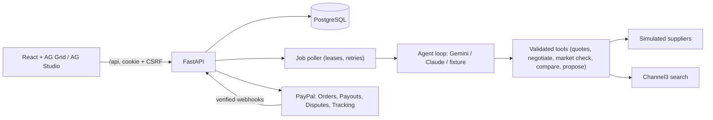

# TradePilot AI

An AI purchasing agent for a small electronics retailer that **buys within the owner's rules and pays with PayPal**.
It also meters its own tool use and pays for it through PayPal, and it **defends the storefront when a buyer disputes a payment**.

- **The AI does the legwork:** it requests quotes, negotiates within each supplier's policy, checks retail prices and explains the trade-offs.
- **The server does the deciding:** it owns prices, arithmetic, ranking, stock and every payment step.
- **The owner approves an exact cart** before anything is paid.

> **Status, plainly.** Everything below runs and is tested **offline** (fixture AI and a fixture PayPal stand-in, 82 backend
> tests + 5 browser tests). Calls against **real Gemini, PayPal Sandbox, Payouts, Disputes and Channel3 have not yet been
> executed** — they are implemented against the published APIs and are listed as pending in
> [docs/verification.md](docs/verification.md). Nothing in this repo should be read as externally verified until that file says so.

## What it does

| | Feature | PayPal | AI |
|---|---|---|---|
| 1 | **Agentic procurement** | Orders v2 create, server capture, webhooks, reconciliation | Gemini (or Claude) chooses suppliers, negotiation moves and writes the explanation |
| 2 | **Pay-per-call tools** — every quote, negotiation round and market check costs 1–2¢ | Wallet top-up via Orders checkout; providers settled with **Payouts** | The agent decides which paid tools are worth calling |
| 3 | **Dispute defense** for the storefront | Disputes webhook + `provide-evidence`, order **tracking** push | Drafts a response where every claim cites a stored record; owner approves the exact text |

### The demo story (reproducible, offline)
1. The owner asks: *"Restock everything we're short on before the weekend rush. Keep it under $500 delivered, and we need it within 3 days."*
   TradePilot proposes quantities from a transparent formula and suggests a budget and deadline. Nothing goes to
   suppliers until the owner confirms these requirements.
2. The agent quotes three simulated suppliers, then makes its recommendation:
   - **Apex**, $470.00, is the best offer.
   - **Cobalt**, $455.00, is rejected because its Lightning cable lacks the required certification.
   - **Brightline** negotiates from $510.00 to $488.00, partly by offering a compatible surplus charger.
3. A labeled scenario raises Apex's prices, and the old $470 approval is **refused by the server** (`supplier terms changed`).
   The re-run proposes Brightline at **$488.00**, which is $22.00 below Brightline's own $510.00 list-price basket.
4. The owner approves the exact cart, which reserves supplier stock for 15 minutes. PayPal checkout follows, then the
   server captures the payment.
5. A shared idempotent finalizer records the capture once, consumes the stock reservation and raises incoming stock once.
6. Later, the buyer disputes the order. The agent drafts evidence that cites the approval, capture and shipment records. The owner
   approves it and the evidence is sent to PayPal.

## Safety rules the code enforces
- **Money:** amounts are integer cents everywhere, and no amount sent by the client is trusted.
- **Approval:** the owner approves an immutable snapshot, identified by a SHA-256 digest. Any change to price, item, supplier
  or expiry requires a new approval.
- **Payment intent:** every PayPal call first persists its intent (request ID plus exact payload), then runs with no
  database lock held.
  - A timeout is recorded as **unknown** and reconciled later; it is never guessed.
  - Retries reuse the same `PayPal-Request-Id` (and the same `sender_batch_id` for Payouts).
- **One finalizer:** capture responses, verified webhooks and reconciliation all go through the same function, so a payment
  takes effect once. Mismatched amount, payee or correlation sends the purchase to **manual review**.
- **Stock:** reservations are atomic, so two approvals cannot claim the same stock. A capture with an unknown outcome
  keeps its reservation pinned until resolved.
- **What the AI can and cannot do:**
  - It has no tool that approves, pays, captures, makes arbitrary HTTP requests or writes freely to the database.
  - Its tool arguments are strictly validated, and supplier descriptions are treated as untrusted data.
  - Every dollar amount in its explanations must exist in the server's figures, or the proposal or draft is rejected.
- **Sessions:**
  - Each demo session is isolated, with an HttpOnly cookie, a CSRF token and an origin check.
  - Rate limits apply to sessions and runs.
  - Pay-per-call spend is capped per run and per day.

## Architecture



More detail is in [docs/architecture.md](docs/architecture.md).

## Sponsor technology
- **PayPal (required):**
  - Orders v2: create, retrieve, capture, and tracking.
  - Webhook signature verification.
  - Payouts.
  - Disputes: retrieve and provide-evidence.
- **AG Grid:**
  - **AG Grid Community** powers the inventory, offer-comparison and tool-usage grids, with CSV export.
  - **AG Studio** powers the Insights dashboard over live session data. It needs a licence key, and without one it shows a watermark.
- **Channel3:** the paid `check_market_price` tool calls Channel3 product search (`CHANNEL3_MODE=live`). Without a key it uses
  labeled fixture listings.
- **Render:** the repo includes a blueprint (`render.yaml`) for one Docker service plus PostgreSQL.

## Run it locally (offline, no keys needed)

Prerequisites: Python 3.13, [uv](https://docs.astral.sh/uv/), Node.js 24, PostgreSQL 17.

1. Create the database user and the two databases:
   ```bash
   createuser tradepilot --pwprompt   # password: local-dev-only (matches .env.example)
   createdb -O tradepilot tradepilot
   createdb -O tradepilot tradepilot_test
   ```
2. Copy the example settings. This starts in offline fixture modes.
   ```bash
   cp .env.example .env
   ```
3. Install the backend, apply migrations and start the API:
   ```bash
   cd backend
   uv sync
   uv run python -m app.cli migrate
   uv run uvicorn app.main:app --port 8000
   ```
4. In a second terminal, start the frontend:
   ```bash
   cd frontend
   npm ci
   npm run dev
   ```

Then open http://localhost:5173. The header badges show which AI and payment modes are active.

**Single port:** to serve the built frontend from FastAPI instead, run `npm run build` in `frontend/`, then open http://localhost:8000.

**Docker:** `docker compose up --build`, then open http://localhost:8000. This needs Docker; the image was **not** built
on the authoring machine (see verification).

## Live modes (real AI and PayPal Sandbox)
Set these in `.env`. Live modes never fall back to fixtures: missing credentials stop startup with a clear message.

| Setting | Where to get it |
|---|---|
| `AI_MODE=gemini`, `GEMINI_API_KEY`, `GEMINI_MODEL` | aistudio.google.com (free tier). Or `AI_MODE=anthropic` with `ANTHROPIC_API_KEY`, `ANTHROPIC_MODEL` |
| `PAYMENT_MODE=paypal_sandbox`, `PAYPAL_CLIENT_ID`, `PAYPAL_CLIENT_SECRET` | developer.paypal.com → Apps & Credentials (Sandbox) |
| `PAYPAL_MERCHANT_ID` | Sandbox **Business** account → Account ID (the payee the server validates) |
| `PAYPAL_WEBHOOK_ID` | Add a webhook to the app at `https://<public-host>/api/webhooks/paypal` (locally: `cloudflared tunnel --url http://localhost:8000`). Subscribe to `CHECKOUT.ORDER.APPROVED`, `PAYMENT.CAPTURE.COMPLETED`, `PAYMENT.CAPTURE.PENDING`, `PAYMENT.CAPTURE.DENIED`, `CUSTOMER.DISPUTE.CREATED`, `CUSTOMER.DISPUTE.UPDATED`, `CUSTOMER.DISPUTE.RESOLVED` |
| `PAYPAL_PAYOUT_RECEIVER` | Email of a Sandbox **Personal** account (receives provider Payouts) |
| `CHANNEL3_MODE=live`, `CHANNEL3_API_KEY` | channel3.ai |
| `VITE_AG_STUDIO_LICENSE_KEY` | AG Studio 45-day trial |

The buyer approves checkout in **PayPal's own window**, logged in as the Sandbox Personal account. The app never asks for
PayPal credentials.

## Tests
```bash
cd backend && uv run ruff check . && uv run pytest -q   # 82 tests; uses tradepilot_test
cd frontend && npx playwright test                      # 5 tests; builds the SPA, uses tradepilot_e2e
```
Before the first browser test run:
1. Run `createdb -O tradepilot tradepilot_e2e`.
2. Run `npx playwright install chromium`.

Fault-injection tests make the offline PayPal stand-in commit and then "lose" its response. They are labeled as such and
are not evidence of PayPal behaviour.

## Operations
- **One instance, one worker:** the job poller (agent runs, webhook processing, reconciliation, dispute intake) runs inside
  the app process. Jobs are persisted with leases, so a crashed run resumes or fails visibly after a restart.
- **CLI:** `python -m app.cli {check-config|migrate|seed|run-jobs|expire-reservations|reconcile-pending}`.
- **Health:** `GET /api/health` reports the process; `GET /api/ready` also checks the database and the migration head.

## Limitations
- **Simulated parts:** the suppliers, the retailer data, the carrier and the scenario events are synthetic and clearly labeled.
- **One payee:** all restock payments go to one demo storefront (a PayPal Sandbox business account). Suppliers are offer
  sources, not PayPal payees.
- **Tax:** excluded in this synthetic scenario. Only USD is supported.
- **Payment scope:** refunds and post-payment cancellations go to manual review.
- **Disputes:** evidence is submitted as notes plus tracking, with no document uploads.
- **AG Studio:** the assistant panel is not connected to an LLM, and Studio's built-in table widget is replaced by a chart.
- **Auth:** production authentication and roles are out of scope. Demo sessions stand in for accounts.

## Repository
```
backend/    FastAPI app (app/), Alembic migrations, pytest suite
frontend/   React + TypeScript + Vite, AG Grid, AG Studio, Playwright e2e
fixtures/   products, sales, suppliers, paid-tool registry, market listings, scenarios
docs/       architecture, verification, demo script, submission text, build contract
```

## License
See [LICENSE](LICENSE). The copyright holder line is a placeholder until the owner chooses it. Third-party packages keep their
own licences; AG Studio and AG Grid Enterprise are commercial (trial licence).
